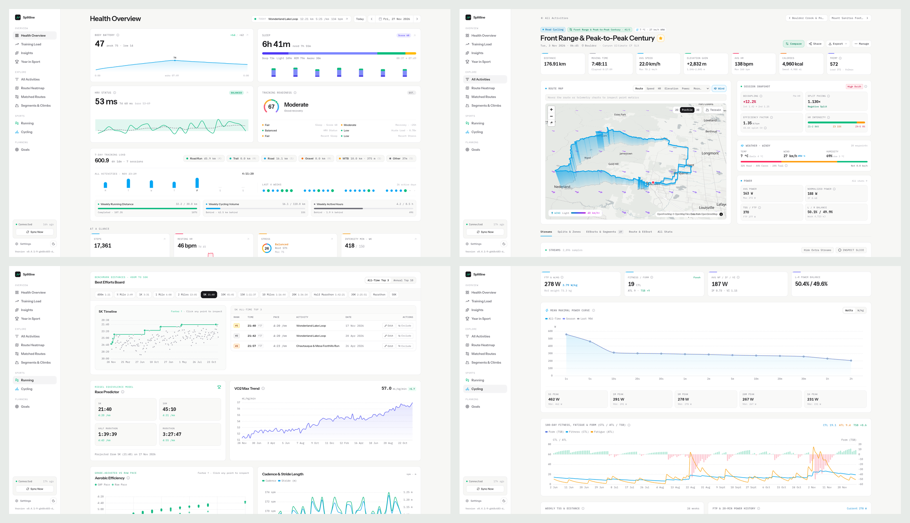

# Splitline

Local-first, self-hosted personal endurance and health telemetry platform. Splitline syncs your daily health metrics, workouts, FIT telemetry streams, and historical activity weather into a single SQLite database, packaged as a multi-architecture Docker container with no external database or cache services.

Currently supports the **Garmin Connect Personal API** (`GARMIN_KEY`).



> See more screenshots of dashboards, sport hubs, FIT telemetry, and settings in [docs/screenshots](docs/screenshots/README.md).

## Features

- **Daily Health & Recovery**: Sleep stages, HRV, resting heart rate, Body Battery, stress, SpO2, weight, VO2 Max, training readiness, and trend charts.
- **FIT Streams & Best Efforts**: Caches original FIT archives locally to parse second-by-second pace, heart rate, cadence, power, elevation, and GPS streams, with offline Best Efforts recalculation.
- **Sports & Disciplines**: Auto-detected or customizable hubs for Running, Cycling, Hiking, Walking, Swimming, and Strength & Cardio, plus a discipline reclassification inbox.
- **Historical Weather & Wind Maps**: Route-sampled weather via Open-Meteo (no API key required), with headwind/crosswind/tailwind breakdowns, wind-colored route overlays, and directional wind arrows.
- **GPS Route Heatmap**: Interactive MapLibre GL heatmap filterable by sport, discipline, and date range.
- **Gear & Goals**: Equipment mileage and retirement tracking, plus distance, elevation, duration, and session goals with streaks.
- **Units & Appearance**: Metric/Imperial switching and Light, Dark, or System themes.

## Quick Start

Pre-built `linux/amd64` and `linux/arm64` images are published to `ghcr.io/splitline-php/splitline` (`:latest`, semver tags such as `:1`, `:1.2`, `:1.2.3`, and `:edge` from `main`).

### 1. Download Compose files

```bash
mkdir splitline && cd splitline
curl -fsSLO https://raw.githubusercontent.com/splitline-php/splitline/main/deploy/docker/compose.yaml
curl -fsSLO https://raw.githubusercontent.com/splitline-php/splitline/main/deploy/docker/.env.example
cp .env.example .env
```

### 2. Configure and start

Set `TIMEZONE`, `GARMIN_KEY`, and `APP_URL` in `.env` (see [Configuration](#configuration)), then start the container:

```bash
docker compose up -d
```

Open `http://localhost:8080`. On first boot, Splitline creates `/data/database.sqlite`, runs migrations, and starts background workers and a 30-minute sync schedule.

> **Security**: Splitline serves plain HTTP on port `8080` with no built-in authentication or TLS. You are responsible for restricting access and terminating HTTPS in front of it; never expose port `8080` directly to the internet. See [SECURITY.md](SECURITY.md).

### 3. Backfill history

```bash
docker exec -it splitline php artisan garmin:check
docker exec -it splitline php artisan garmin:sync --backfill
docker exec -it splitline php artisan garmin:sync-streams --queue
docker exec -it splitline php artisan weather:sync --queue
```

### Building locally

```bash
cd deploy/docker
cp .env.example .env
docker compose -f compose.yaml -f compose.local.yaml up -d --build
```

## Updating & Backups

### Updating

```bash
docker compose pull
docker compose up -d
```

Migrations run automatically on startup. Persistent data is stored in `splitline_data` (`/data`) and `splitline_fits` (`/var/www/html/storage/app/private`).

### Upgrading from v0.1.x (breaking)

> [!WARNING]
> Starting with v0.2.0 the image is built on Alpine instead of Debian. The container user's ID changed from `33` to `82`, so volumes created by v0.1.x **cannot be reused**. A plain `docker compose pull && docker compose up -d` will fail on startup with a "not writable" error.

To upgrade, recreate your Docker setup from scratch and re-import your data:

```bash
docker compose down -v
docker compose pull
docker compose up -d
```

`down -v` permanently deletes the `splitline_data` and `splitline_fits` volumes, including your auto-generated `APP_KEY`. After starting the new container, run the initial Garmin backfill again (see [Artisan Commands](#artisan-commands)). Anything entered manually in Splitline (goals, weight goals, gear and gear assignments, and settings) is not stored in Garmin and must be re-entered.

### Live SQLite backup

SQLite runs in WAL mode, so use `.backup` instead of copying the database file directly while running:

```bash
docker exec splitline sqlite3 /data/database.sqlite ".backup '/data/splitline-backup.sqlite'"
docker cp splitline:/data/splitline-backup.sqlite ./splitline-backup-$(date +%F).sqlite
docker exec splitline rm -f /data/splitline-backup.sqlite
```

Back up `splitline_fits` as well to keep cached FIT archives without re-downloading them.

## Artisan Commands

Prefix commands with `docker exec -it splitline` when running in Docker.

| Command                                                                                           | Description                                                                                |
| :------------------------------------------------------------------------------------------------ | :----------------------------------------------------------------------------------------- |
| `php artisan garmin:check [--refresh]`                                                            | Verify `GARMIN_KEY` and Garmin Connect Personal API connectivity.                          |
| `php artisan garmin:sync [--days=7]`                                                              | Incremental sync of health summaries and activities (runs every 30 minutes).               |
| `php artisan garmin:sync --backfill [--from=YYYY-MM-DD]`                                          | Resumable all-time history backfill from Garmin.                                           |
| `php artisan garmin:sync-streams [--limit=N] [--activity=ID] [--force] [--redownload] [--queue]`  | Download, cache, and parse FIT streams, GPS routes, and Best Efforts.                      |
| `php artisan weather:sync [--limit=N] [--activity=ID] [--force] [--upgrade-only] [--queue]`       | Fetch and store historical Open-Meteo weather for outdoor activities.                      |
| `php artisan routes:match [--rebuild] [--queue] [--chunk=100]`                                    | Fingerprint outdoor GPS polylines and cluster repeated matched routes.                     |
| `php artisan segments:scan [--rebuild] [--queue] [--chunk=50]`                                    | Auto-detect climbs and match personal segments across outdoor streams.                     |
| `php artisan activities:compute-derived-metrics [--activity=ID] [--force] [--queue] [--chunk=25]` | Compute aerobic decoupling (Pa:Hr / Pw:Hr), EF, and pacing metrics.                        |
| `php artisan geocode:sync [--queue] [--limit=50] [--force]`                                       | Reverse-geocode matched routes, segments, and activities missing place names.              |
| `php artisan import:scan [--dir=PATH] [--mode=keep\|archive] [--no-age-check]`                    | Scan the configured auto-import folder for new `.fit` and `.zip` files (runs every 5 min). |

## Configuration

Everything except `GARMIN_KEY` has a built-in default and can be omitted unless you want to override it. Open-Meteo weather and Nominatim place naming work out of the box.

| Variable                           | Default                               | Description                                                                                                                                                                    |
| :--------------------------------- | :------------------------------------ | :----------------------------------------------------------------------------------------------------------------------------------------------------------------------------- |
| `APP_URL`                          | `http://localhost:8080`               | Public URL of your instance (`https://...` behind TLS termination).                                                                                                            |
| `APP_KEY`                          | _(auto-generated)_                    | Laravel encryption key; auto-generated at `/data/.app_key` if omitted.                                                                                                         |
| `TIMEZONE`                         | `UTC`                                 | IANA timezone for dates, streaks, and daily rollups (falls back to `TZ`).                                                                                                      |
| `DEFAULT_UNITS`                    | `metric`                              | Initial unit system (`metric` or `imperial`); overridable in Settings.                                                                                                         |
| `DEFAULT_SPORTS_MODE`              | `auto`                                | Initial Sports & Disciplines navigation mode (`auto` or `custom`).                                                                                                             |
| `GARMIN_KEY`                       | _(empty)_                             | Garmin Connect Personal API key.                                                                                                                                               |
| `GARMIN_AUTO_SYNC_STREAMS`         | `true`                                | Automatically queue FIT stream & GPS route downloads for newly synced activities (caches FIT ZIPs in `splitline_fits`; set to `false` to opt out on initial backfill).         |
| `TRUSTED_PROXIES`                  | _(empty)_                             | Reverse proxy IP/CIDR list or `*` for forwarded HTTPS headers.                                                                                                                 |
| `SESSION_SECURE_COOKIE`            | `false`                               | Set to `true` when serving over HTTPS.                                                                                                                                         |
| `LOG_CHANNEL`                      | `stderr` _(Docker)_ / `stack` _(dev)_ | Log destination (`stderr` for `docker logs`).                                                                                                                                  |
| `DB_DATABASE`                      | `/data/database.sqlite` _(Docker)_    | Path to the SQLite database file.                                                                                                                                              |
| `DB_SQLITE_JOURNAL_MODE`           | `WAL` _(Docker)_                      | SQLite journal mode for concurrent web, queue, and scheduler access.                                                                                                           |
| `DB_SQLITE_BUSY_TIMEOUT`           | `5000` _(Docker)_                     | SQLite busy timeout in milliseconds.                                                                                                                                           |
| `OPEN_METEO_ENABLED`               | `true`                                | Enable historical activity weather lookups.                                                                                                                                    |
| `OPEN_METEO_AUTO_SYNC`             | `true`                                | Automatically queue weather lookups for newly synced outdoor activities.                                                                                                       |
| `NOMINATIM_ENABLED`                | `true`                                | Enable reverse geocoding for Matched Routes and outdoor activities missing `location_name`.                                                                                    |
| `NOMINATIM_AUTO_SYNC`              | `true`                                | Automatically queue background reverse geocoding for matched routes and outdoor activities missing location names.                                                             |
| `NOMINATIM_BASE_URL`               | `https://nominatim.openstreetmap.org` | Nominatim endpoint URL (point to a self-hosted Nominatim instance to remove public rate limits).                                                                               |
| `NOMINATIM_RATE_LIMIT_MS`          | `1100`                                | Minimum spacing in milliseconds between Nominatim requests (enforces ≥1000ms on the public OSMF host; set to `0` for self-hosted instances).                                   |
| `NOMINATIM_USER_AGENT`             | _(Splitline/version)_                 | Custom HTTP `User-Agent` header (defaults to `Splitline/{version} (+https://github.com/splitline-php/splitline)`).                                                             |
| `NOMINATIM_REFERER`                | _(empty)_                             | Optional HTTP `Referer` header sent to Nominatim (only sent when explicitly configured).                                                                                       |
| `NOMINATIM_EMAIL`                  | _(empty)_                             | Optional contact email (not required, but recommended on the public OSMF endpoint per their usage policy).                                                                     |
| `NOMINATIM_TIMEOUT`                | `15`                                  | HTTP request timeout in seconds for Nominatim reverse lookups.                                                                                                                 |
| `NOMINATIM_MAX_RETRIES`            | `2`                                   | Maximum retry attempts for transient connection/5xx errors.                                                                                                                    |
| `NOMINATIM_NEGATIVE_CACHE_DAYS`    | `30`                                  | Days to remember coordinates Nominatim could not resolve before asking again.                                                                                                  |
| `NOMINATIM_RETRY_FAILED_DAYS`      | `7`                                   | Days before a route or activity whose lookup found no usable place name is retried.                                                                                            |
| `AUTO_IMPORT_DIR`                  | _(empty)_                             | Optional drop folder scanned every 5 minutes for `.fit` and `.zip` files (e.g., `/data/imports` synced via Syncthing, HealthFit, RunGap, or NFS).                              |
| `AUTO_IMPORT_MODE`                 | `keep`                                | Drop-folder file handling: `keep` (read-only safe, deduplicates via inner-FIT SHA-256) or `archive` (moves processed files to `processed/` and failures to `failed/`).         |
| `AUTO_IMPORT_MIN_FILE_AGE_SECONDS` | `5`                                   | Minimum file modification age in seconds before ingesting. Files are also only imported once their size and mtime are unchanged since the previous scan; symlinks are ignored. |

## Development

See [CONTRIBUTING.md](CONTRIBUTING.md) for local setup, CI checks, and contribution guidelines.

## Attribution & Disclaimer

- **Weather**: [Open-Meteo.com](https://open-meteo.com/), licensed under [CC BY 4.0](https://creativecommons.org/licenses/by/4.0/).
- **Maps**: OpenFreeMap vector tiles and OpenStreetMap data.
- **Place Naming (Geocoding)**: [OpenStreetMap Nominatim](https://nominatim.openstreetmap.org/) — place names © OpenStreetMap contributors, licensed under [ODbL](https://www.openstreetmap.org/copyright).
- **Disclaimer**: Splitline is an independent open-source project and is not affiliated with, endorsed by, or sponsored by Garmin Ltd. or its subsidiaries. Garmin and Garmin Connect are trademarks of Garmin Ltd. or its subsidiaries.

## License

Licensed under the [MIT License](LICENSE).
